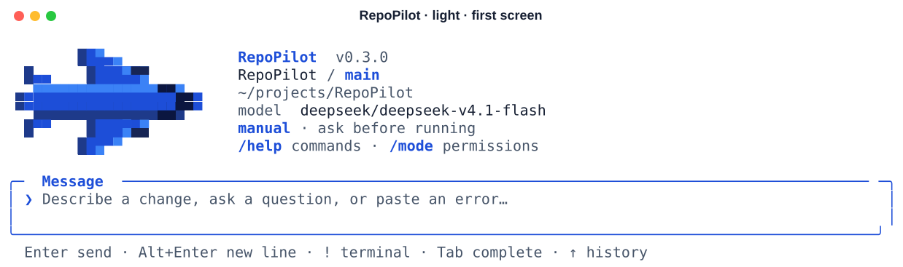
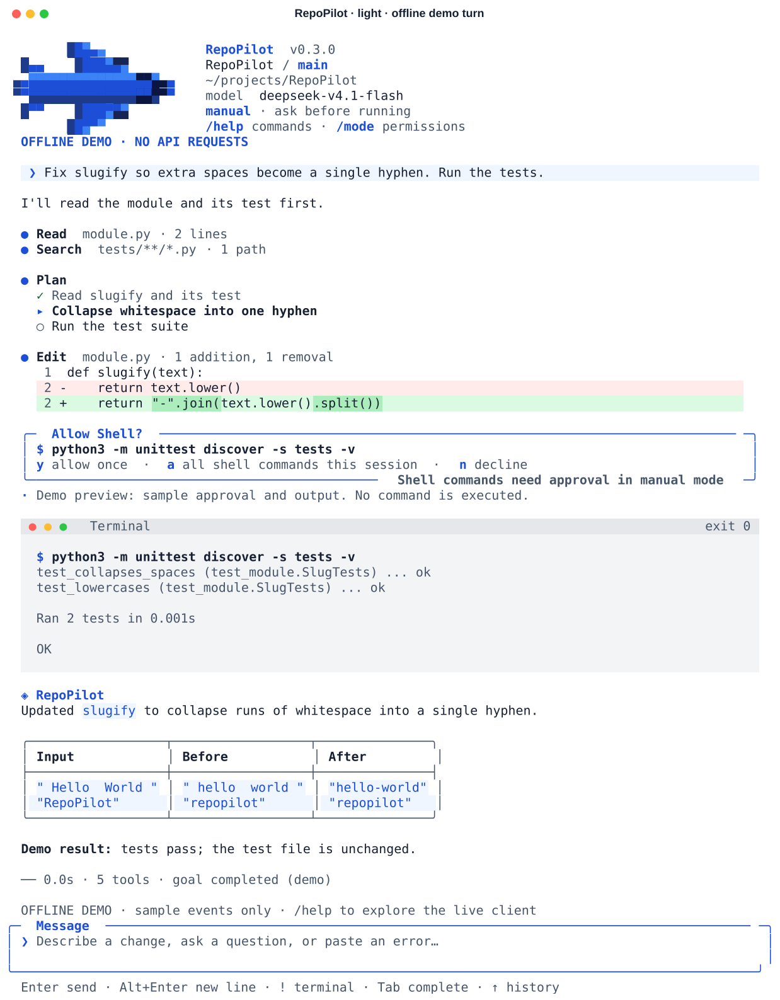

# RepoPilot

面向真实 Git 仓库的软件工程 Agent 学习项目。基于 *learn-claude-code* s01–s17 的机制，构建从仓库理解、任务规划、代码修改到测试反馈与目标判断的执行闭环。它是可运行、可测试的学习型 Harness，尚不是隔离完善的生产环境执行平台。

## 快速开始

需要 Python 3.10+ 和 Git。提供带输入历史、命令补全、工具时间线、差异预览和权限确认的终端客户端。推荐建立隔离环境：

```bash
python3 -m venv .venv
source .venv/bin/activate
python -m pip install -e .
cp .env.example .env
```

填写 `.env` 中的 `OPENAI_API_KEY`、`MODEL_ID`，可选 `OPENAI_BASE_URL`。采用 OpenAI-compatible Chat Completions，模型应支持工具调用和 JSON 对象输出。请求有 60 秒默认超时、有限重试，可设置备用模型。现有环境变量优先于 `.env`。

```bash
repopilot /path/to/repository
# 也可在项目根目录使用 python main.py 或 python -m repopilot

# 使用指定模型和现有配置，不修改 .env
repopilot /path/to/repository --env-file /path/to/.env \
  --base-url https://api.360.cn/v1 \
  --model deepseek/deepseek/deepseek-v4.1-flash

# 无需 API 密钥即可查看离线界面演示
repopilot --demo

# 按终端底色选择主题（默认 auto）
repopilot --theme light
repopilot --theme dark

# 权限模式：manual 需要审批（默认），auto 无需审批
repopilot --mode manual
repopilot --mode auto
```

目标必须是 Git 仓库。省略路径使用当前目录；输入任务开始工作，`/help` 查看命令，`/exit` 或 `Ctrl+D` 退出。`/model` 切换模型，`/diff` 查看改动，`/status` 查看用量与当前模式。`manual` 模式下 Shell 等受保护操作需要确认，审批时 `y` 放行一次、`a` 在本会话内放行同类操作（破坏性命令仍逐条询问）、`n` 拒绝；只有前台终端轮次可以确认，其余轮次默认拒绝需确认的工具。`auto` 模式自动批准受保护操作，并传递给子任务、工作流和队友；原有禁用命令与仓库路径边界继续生效。会话内用 `/mode manual`、`/mode auto` 切换。Windows 安装与完整快捷键见 [CLI 使用说明](docs/cli.md)。

<picture>
  <source media="(prefers-color-scheme: dark)" srcset="assets/brand/client-dark.svg">
  
</picture>

`manual` 模式下，单次执行或异步执行需要提前授权**完全相同**的命令；也可通过 `--mode auto` 自动批准：

```powershell
.venv/Scripts/python.exe main.py . --task "运行项目测试并报告结果" --allow-command "python -m unittest discover -s tests -v"
```

`--task` 结束后立即关闭运行时，不等待未来的定时任务。交互模式会在空闲时自动接收后台与团队事件并触发下一轮。退出会停止队友和受管理的 shell 进程。

## 界面预览

一轮完整对话（`repopilot --demo` 离线演示，不调用模型；浅色 / 深色主题）：

<picture>
  <source media="(prefers-color-scheme: dark)" srcset="assets/brand/terminal-preview-dark.svg">
  
</picture>

- **工具调用一行一条**：`● Read  module.py · 2 lines`，连续的读取与搜索排成列表；等待时显示带流光与计时的 `Thinking…  12s`。
- **代码改动**：带文件行号的 diff，新增行绿底、删除行红底，改写的单词再加深标出。
- **终端窗口**：Agent 执行的命令与用户以 `!` 输入的命令都显示为浅灰终端窗口，标题栏带退出码与耗时，失败时变红。
- **紧凑授权卡**：说明原因与可选按键，回答后只留一行结果；`a` 在本会话内放行普通 Shell 命令。
- **回答**：标题左对齐，代码块、表格与行内代码使用主题底色；超过 30 秒的任务结束时响铃并发送桌面通知。

截图由 `python scripts/render_screenshots.py` 生成。

## 按验收条件持续工作

```text
/goal 修复登录模块，直到指定测试命令退出码为 0，保持已有接口且不修改测试文件
/goal
/goal clear
```

设置目标立即启动任务。独立判断器只检查当前会话的工具证据，不读取仓库；没有证据不会可靠地证明完成。后台结果未到时延后判断，结果到达后继续。达到主循环 100 轮或 Stop 连续续行三次时返回控制权，并保留未完成目标。判断器错误与不可能完成也会明确记录。目标状态持久化，但完整模型会话不自动恢复，重启后需重新提供或运行验证。

## 能力与依赖

| 阶段 | 核心能力 |
| --- | --- |
| s01–s04 | Agent Loop、五个基础工具、权限策略、类封装 HookManager |
| s05–s08 | 任务清单、一次性子 Agent、技能按需加载、可恢复上下文管理 |
| s09 | 持久记忆：显式写入、相关召回、自动提取与事务整理 |
| s10 | 持久任务图、环检测、依赖检查与原子认领 |
| s11 | 显式后台命令、退出码与完成通知、进程清理 |
| s12 | 本地五字段 Cron、持久待交付状态与模型接收确认 |
| s13 | 持久队友、消息收件箱、计划审批、任务绑定 worktree |
| s14 | 真实 stdio MCP 连接、动态工具发现与宿主授权 |
| s15 | 串行会话宿主、事件唤醒、统一权限与模型错误恢复 |
| s16 | 注册工作流、并行/流水线、结构校验与 journal 续跑 |
| s17 | 独立目标判断、延后检查、持续推进和有界退出 |

实现按依赖组织，非简单复制章节脚本：任务图先于团队，后台与调度分别实现后在宿主集成；MCP 从基础工具独立扩展；工作流和目标判断可以分别使用。详见 [阶段说明](docs/milestones.md)、[运行时架构](docs/runtime.md)、[运行与排错](docs/operations.md)、[评测说明](docs/evaluation.md) 和 [s01–s08 基础设计](docs/architecture.md)。

## 技能、团队、MCP 与工作流

技能从**目标仓库** `skills/*/SKILL.md` 扫描，系统提示只加入名称和描述；模型通过 `load_skill` 读取全文。本仓库含 `repository-workflow` 示例，元数据支持简单单行格式。

复杂任务可先创建 task 节点，取得实际 ID，再添加依赖边，然后启动 ready task 的队友。一次性 `task` 只返回总结；持久队友保持身份和消息历史，在 WORK/IDLE 间切换。计划审批绑定任务版本，过期审批无效。worktree 分离工作目录和 codex/ 分支，不自动合并、删除或推送任务分支。

MCP 通过**宿主显式提供**的 JSON 文件配置，使用 `--mcp-config path/to/mcp.json`：

```json
{
  "docs": {
    "command": ["python", "D:/tools/docs_server.py"],
    "allow_tools": ["search"]
  }
}
```

`connect_mcp` 启动已配置程序并发现工具；连接需确认，未精确列入 allow_tools 的外部工具也需确认。不要把任意仓库提供的命令当作可信宿主配置。当前 MCP 支持 stdio 工具路径，不支持 HTTP、采样或资源订阅；协议依据 [官方 stdio 规范](https://modelcontextprotocol.io/specification/2025-11-25/basic/transports)。

内置 `Workflow(name="review-changes", args={"changes": "实际 diff 内容"})` 先审计再验证两个维度，返回结构化发现、运行 ID 与事件。使用相同名称、参数和 `resume_from_run_id` 可续跑。模型只能提供参数，不能生成执行脚本。

## 测试与 Agent Evaluation

更完整的四项仓库任务测试使用 `python -m repopilot.benchmark --output-root D:/学习/RepoPilot-agent-tests`。它保留独立仓库、对话、补丁和外部验收结果，统计 Goal 误报、耗时、API 调用与 Token；详见 [性能测试说明](docs/benchmark.md)。

2026-09-18 首次实测：功能验收 4/4，完整自主任务 3/4，本地自动化测试 42/42。失败、耗时与适用范围见 [实测记录](docs/benchmark-results.md)。

```powershell
python -m unittest discover -s tests -v
python -m repopilot.evaluation --mode demo
python -m repopilot.evaluation --mode live --output .repopilot/eval-live.json
```

`demo` 是固定脚本验证 Harness：在三个临时 Git 仓库中，先证实测试失败，执行修改，再独立重跑测试，检查测试文件未变和修改范围。它的通过率**不是模型完成率**。`live` 使用现有模型配置完成相同小任务，可以通过 `--case` 选择单个样例；仅能作为冒烟评测，不能替代复杂仓库基准或对照实验。报告记录退出码、修改文件、目标状态、耗时和错误。GitHub Actions 在 Windows/Linux 和 Python 3.10/3.12 上运行无密钥测试与 demo。

## 数据与边界

持久数据在目标仓库 `.repopilot/`：SQLite 保存记忆、任务、调度、消息、工作流 journal 和目标状态；runs 保存工具原文与历史归档，workflows 保存快照，worktrees 保存任务 checkout。对其他仓库运行时，应将该目录加入 `.gitignore`。记录可能包含代码与命令输出，不自动删除。

文件工具限制仓库内路径并禁止覆盖 Git 和运行时元数据。shell、子 Agent、队友、MCP 子进程和 worktree **不是安全沙箱**，前台授权命令可访问宿主权限允许的资源。Cron 只在进程运行时检查到期，不补跑停机期间错过的分钟，持久交付采用至少一次语义；多个宿主同时运行同一仓库的定时任务仍可能重复执行。计划闸门不替代用户审批。摘要、记忆提取和目标判断均可能受模型误判影响，需要检查真实测试结果与 Git diff。
